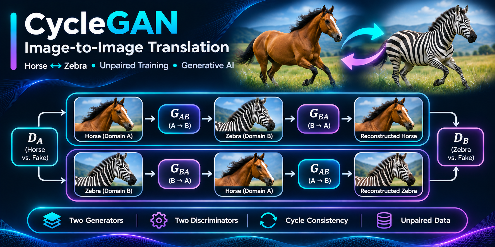
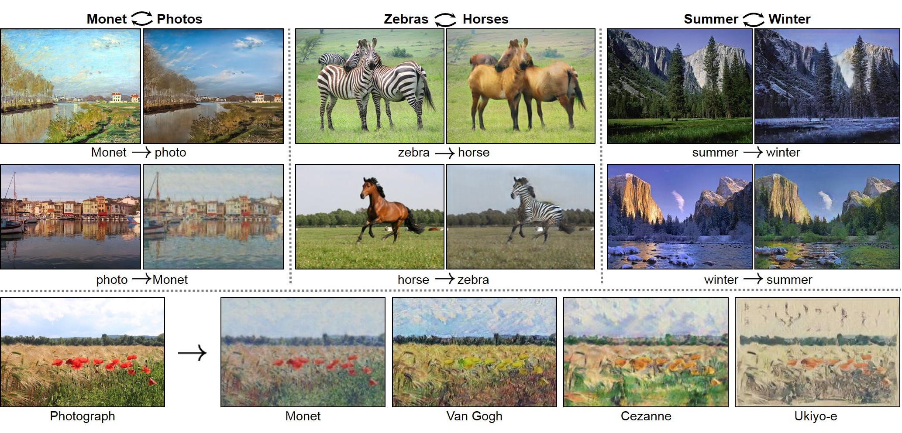
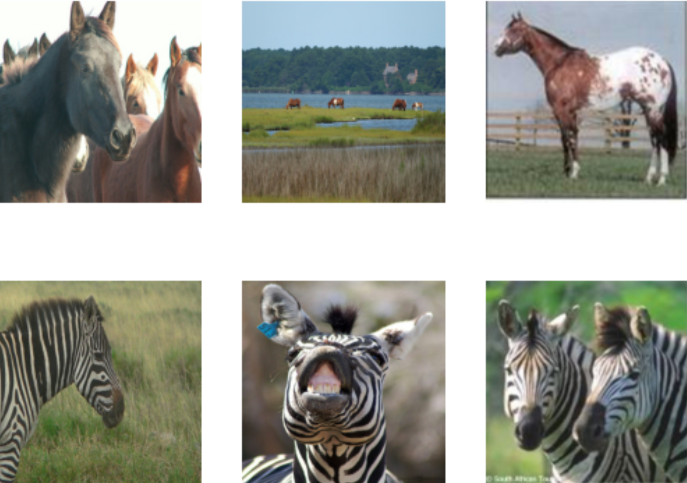
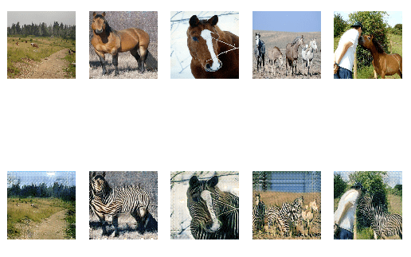

<p align="center">
  
</p>

<h1 align="center">CycleGAN: Unpaired Image-to-Image Translation</h1>

<p align="center">
  A from-scratch implementation of <b>CycleGAN</b> in TensorFlow/Keras, translating <b>horses → zebras</b> and <b>zebras → horses</b> without paired training data.
</p>

<p align="center">
  
  
  
  
</p>

---

## Table of Contents

- [Overview](#overview)
- [How CycleGAN Works](#how-cyclegan-works)
- [Model Architecture](#model-architecture)
- [Project Structure](#project-structure)
- [Installation](#installation)
- [Dataset](#dataset)
- [Usage](#usage)
- [Training Configuration](#training-configuration)
- [Results](#results)
- [References](#references)

---

## Overview

**CycleGAN** (Cycle-Consistent Generative Adversarial Network) is a generative model that learns a mapping between two image domains, such as photographs and paintings or horses and zebras, using **unpaired** datasets. It does not need image pairs that correspond pixel for pixel. Instead, it relies on a *cycle-consistency* constraint: an image translated to the other domain and back should look like the original.

<p align="center">
  
  <br>
  <em>Figure 1. Image-to-image translation maps images from one visual domain to another.</em>
</p>

In this repository, every component (generators, discriminators, composite training models, image pool and training loop) is built from scratch and applied to the classic **horse2zebra** dataset.

## How CycleGAN Works

The model trains **two generators** and **two discriminators** at the same time:

| Component | Role |
|-----------|------|
| `G_AB` | Translates Domain A (horse) → Domain B (zebra) |
| `G_BA` | Translates Domain B (zebra) → Domain A (horse) |
| `D_A`  | Distinguishes real horses from generated horses |
| `D_B`  | Distinguishes real zebras from generated zebras |

Each generator is updated through a **composite model** that combines four objectives:

| Loss | Type | Weight | Purpose |
|------|------|:------:|---------|
| Adversarial | MSE (LSGAN) | 1 | Make translated images look real to the discriminator |
| Identity | L1 (MAE) | 5 | Keep an image unchanged when it is already in the target domain |
| Forward cycle | L1 (MAE) | 10 | `A → B → A` should reconstruct the original `A` |
| Backward cycle | L1 (MAE) | 10 | `B → A → B` should reconstruct the original `B` |

To stabilise training, discriminators are updated with a **history buffer of 50 generated images** (image pool) rather than only the latest generator outputs.

## Model Architecture

**Generator: ResNet-based encoder–transformer–decoder**

```
c7s1-64 → d128 → d256 → 9 × ResNet blocks (256) → u128 → u64 → c7s1-3 → tanh
```

- Convolution + Instance Normalization + ReLU
- Two stride-2 downsampling layers and two transposed-convolution upsampling layers
- 9 residual blocks for 256×256 images

**Discriminator: 70×70 PatchGAN**

```
C64 → C128 → C256 → C512 → C512 → 1-channel patch output
```

- 4×4 convolutions, LeakyReLU (α = 0.2), Instance Normalization
- Classifies overlapping image patches as real or fake rather than the whole image

All weights are initialised from a normal distribution (σ = 0.02) and optimised with **Adam** (lr = 2e-4, β₁ = 0.5).

## Project Structure

```
CycleGAN_Image-to-image-Translation/
├── doc/                      # Images used in this README
├── horse2zebra/              # Sample of the dataset in the expected layout
│   ├── trainA/               # Horses (train)
│   ├── trainB/               # Zebras (train)
│   ├── testA/                # Horses (test)
│   └── testB/                # Zebras (test)
├── models/
│   ├── generator.py          # ResNet generator and residual block
│   ├── discriminator.py      # PatchGAN discriminator
│   └── composite_model.py    # Generator training model (adversarial + identity + cycle losses)
├── preprocessing.py          # Loads images, resizes to 256×256, saves horse2zebra_256.npz
├── train.py                  # Training loop
├── util.py                   # Data sampling, image pool, checkpointing, visualisation
└── main.py                   # Entry point: builds the models and starts training
```

## Installation

```bash
git clone <repository-url>
cd CycleGAN_Image-to-image-Translation

pip install tensorflow numpy matplotlib
pip install git+https://www.github.com/keras-team/keras-contrib.git   # InstanceNormalization layer
```

## Dataset

The project uses the **horse2zebra** dataset from the original CycleGAN paper (about 1,000 horse images and 1,300 zebra images). The [`horse2zebra/`](horse2zebra/) folder contains only a few sample images to show the expected layout.

1. Download the full dataset:
   ```bash
   wget https://efrosgans.eecs.berkeley.edu/cyclegan/datasets/horse2zebra.zip
   unzip horse2zebra.zip
   ```
2. Make sure the folders follow the `trainA / trainB / testA / testB` structure shown above.

<p align="center">
  
  <br>
  <em>Figure 2. Sample training data: horses (Domain A, top) and zebras (Domain B, bottom).</em>
</p>

## Usage

**1. Preprocess the data.** Images are resized to 256×256 and stored in a single compressed NumPy file:

```bash
python preprocessing.py
# -> horse2zebra_256.npz
```

**2. Train the model:**

```bash
python main.py
```

During training the script:

- logs discriminator and generator losses at every step: `>step, dA[real,fake] dB[real,fake] g[AtoB,BtoA]`
- saves sample translations after every epoch (`AtoB_generated_plot_XXXXXX.png`, `BtoA_generated_plot_XXXXXX.png`)
- saves generator checkpoints every 5 epochs (`g_model_AtoB_XXXXXX.h5`, `g_model_BtoA_XXXXXX.h5`)

## Training Configuration

| Parameter | Value |
|-----------|-------|
| Image size | 256 × 256 × 3 |
| Pixel scaling | [-1, 1] |
| Batch size | 1 |
| Epochs | 10 (set in `train.py`) |
| Optimizer | Adam (lr = 0.0002, β₁ = 0.5) |
| Image pool size | 50 |
| Loss weights (adv / id / fwd / bwd) | 1 / 5 / 10 / 10 |

> **Tip:** The original paper trains for about 200 epochs. Increase `n_epochs` in [`train.py`](train.py) for higher-quality translations.

## Results

Sample horse → zebra translations after a short training run (input on top, generated output below):

<p align="center">
  
  <br>
  <em>Figure 3. Real horse images (top) and their translated zebra counterparts (bottom).</em>
</p>

## References

- J.-Y. Zhu, T. Park, P. Isola, A. A. Efros. [*Unpaired Image-to-Image Translation using Cycle-Consistent Adversarial Networks*](https://arxiv.org/abs/1703.10593). ICCV 2017.
- [Official CycleGAN project page](https://junyanz.github.io/CycleGAN/)
